# Project 1 — Self-Healing Infrastructure

### Automated Application Recovery Using Prometheus, Alertmanager, Ansible, and Docker

A DevOps automation project that detects application failures and automatically restores service availability without requiring manual intervention.

This project was developed as part of the **Elevate Labs DevOps Internship**.

---

## 1. Project Overview

The Self-Healing Infrastructure project demonstrates automated failure detection, alert management, and application recovery.

The system continuously monitors a containerized Node.js application. When the application becomes unhealthy, Prometheus generates an alert, Alertmanager forwards it to a Python webhook, and Ansible automatically restarts the affected Docker container.

After recovery, the application health endpoint is verified to confirm successful restoration.

### Key Features

- Automated application health monitoring
- Prometheus alert rules
- Alertmanager webhook integration
- Ansible-based container recovery
- Docker Compose deployment
- Recovery cooldown protection
- Duplicate recovery prevention
- Healthy-application protection
- Persistent JSON audit logs
- Recovery success and failure tracking

---

## 2. Architecture

```text
                  ┌───────────────────────┐
                  │ Node.js Application   │
                  │ Docker Container      │
                  │ Port 3005             │
                  └───────────┬───────────┘
                              │
                              │ /metrics
                              ▼
                  ┌───────────────────────┐
                  │ Prometheus            │
                  │ Port 9091             │
                  │ Health Monitoring     │
                  └───────────┬───────────┘
                              │
                              │ Alert Triggered
                              ▼
                  ┌───────────────────────┐
                  │ Alertmanager          │
                  │ Port 9093             │
                  │ Alert Routing         │
                  └───────────┬───────────┘
                              │
                              │ HTTP Webhook
                              ▼
                  ┌───────────────────────┐
                  │ Python Flask Webhook  │
                  │ Ubuntu WSL2           │
                  │ Port 5000             │
                  └───────────┬───────────┘
                              │
                              │ Recovery Request
                              ▼
                  ┌───────────────────────┐
                  │ Ansible Playbook      │
                  │ recover.yml           │
                  └───────────┬───────────┘
                              │
                              │ Docker Restart
                              ▼
                  ┌───────────────────────┐
                  │ Application Recovery  │
                  │ Health Verification   │
                  └───────────────────────┘
```

---

## 3. Technology Stack

| Technology | Purpose |
|---|---|
| Docker | Application containerization |
| Docker Compose | Container orchestration |
| Node.js | Sample application |
| Prometheus | Application metrics and alerting |
| Alertmanager | Alert notification and routing |
| Python | Recovery webhook implementation |
| Flask | HTTP webhook service |
| Ansible | Automated recovery execution |
| Ubuntu WSL2 | Ansible and webhook runtime |
| Git & GitHub | Version control and documentation |

---

## 4. Project Structure

```text
Project-1-Self-Healing/
├── alertmanager/
│   └── alertmanager.yml
├── ansible/
│   ├── inventory.ini
│   └── recover.yml
├── app/
│   ├── Dockerfile
│   ├── package.json
│   └── server.js
├── prometheus/
│   ├── prometheus.yml
│   └── alert-rules.yml
├── webhook/
│   └── server.py
├── screenshots/
├── docker-compose.yml
├── .gitignore
└── README.md
```

**Note:** Authentication secrets, Python virtual environments, and runtime audit logs are excluded from Git.

---

## 5. Application Endpoints

| Endpoint | Purpose |
|---|---|
| `http://localhost:3005/` | Application information, if configured |
| `http://localhost:3005/health` | Application health |
| `http://localhost:3005/metrics` | Prometheus metrics |
| `POST /admin/fail` | Simulate application failure |
| `POST /admin/recover` | Restore application health |
| `http://localhost:9091` | Prometheus dashboard |
| `http://localhost:9093` | Alertmanager dashboard |
| `http://localhost:5000/health` | Webhook health check |

---

## 6. Deployment

### Prerequisites

- Windows 11 with Docker Desktop
- Docker Compose
- Ubuntu WSL2
- Python 3
- Ansible
- Git

### Start Docker Services

From the project directory:

```powershell
docker compose up -d
```

Verify:

```powershell
docker compose ps
```

### Start the Recovery Webhook

Inside Ubuntu WSL2:

```bash
cd /mnt/c/DevOps-Internship/Project-1-Self-Healing
source webhook/.venv/bin/activate
export WEBHOOK_TOKEN="$(cat alertmanager/secrets/webhook-token)"
python webhook/server.py
```

The webhook runs on port `5000`.

**Configuration note:** A local authentication secret must be created and mounted into Alertmanager before starting the webhook. The secret is intentionally excluded from the repository.

---

## 7. Automatic Recovery Workflow

1. Prometheus scrapes application metrics.
2. The application reports its health using `selfhealing_app_healthy`.
3. A failure changes the health metric from `1` to `0`.
4. Prometheus triggers the `SelfHealingAppUnhealthy` alert.
5. Alertmanager sends an authenticated webhook notification.
6. The Flask webhook validates the alert and checks recovery safeguards.
7. Ansible executes `recover.yml`.
8. Docker restarts the application container.
9. Ansible verifies that the application health endpoint returns `UP`.
10. The webhook records the recovery result in a JSON audit log.

### Example Failure Simulation

```powershell
Invoke-RestMethod -Method Post http://localhost:3005/admin/fail
```

Expected:

```text
UNHEALTHY
```

The monitoring system then initiates automatic recovery.

Verify:

```powershell
Invoke-RestMethod http://localhost:3005/health
```

Expected:

```text
UP
```

---

## 8. Recovery Safeguards

### Concurrent Recovery Protection

The webhook prevents multiple Ansible recovery processes from running simultaneously.

Example response:

```json
{"reason":"Recovery already running","status":"ignored"}
```

### Recovery Cooldown

A 120-second cooldown prevents repeated recovery attempts immediately after a recovery request.

Example:

```json
{"reason":"Recovery cooldown active","status":"ignored"}
```

### Healthy Application Protection

The webhook checks the application's actual health before restarting it.

If the application is already healthy, the request is ignored.

```json
{"reason":"Application is already healthy","status":"ignored"}
```

### Authentication

Alertmanager authenticates webhook requests using HTTP Basic Authentication with a locally stored shared secret.

The webhook should remain restricted to the local demonstration environment.

---

## 9. Persistent Recovery Audit Logs

The webhook records recovery activity in:

```text
webhook/logs/recovery-audit.jsonl
```

Examples:

```json
{"event":"recovery_accepted","service":"selfhealing-app"}
{"event":"recovery_completed","result":"success","return_code":0}
{"event":"recovery_ignored","reason":"cooldown_active"}
{"event":"recovery_ignored","reason":"application_already_healthy"}
{"event":"recovery_completed","result":"failed","return_code":1}
```

The actual records also include timestamps.

These logs support troubleshooting and recovery verification.

---

## 10. Testing and Validation

The following scenarios were successfully tested:

| Test Scenario | Result |
|---|---|
| Application health monitoring | Passed |
| Prometheus target discovery | Passed |
| Prometheus alert triggering | Passed |
| Alertmanager integration | Passed |
| Manual Ansible recovery | Passed |
| Automatic webhook-triggered recovery | Passed |
| Concurrent recovery protection | Passed |
| 120-second cooldown | Passed |
| Persistent audit logging | Passed |
| Healthy-application protection | Passed |
| Automatic recovery after hardening | Passed |
| Recovery failure logging | Passed |

---

## 11. Project Screenshots

### Prometheus Target Monitoring

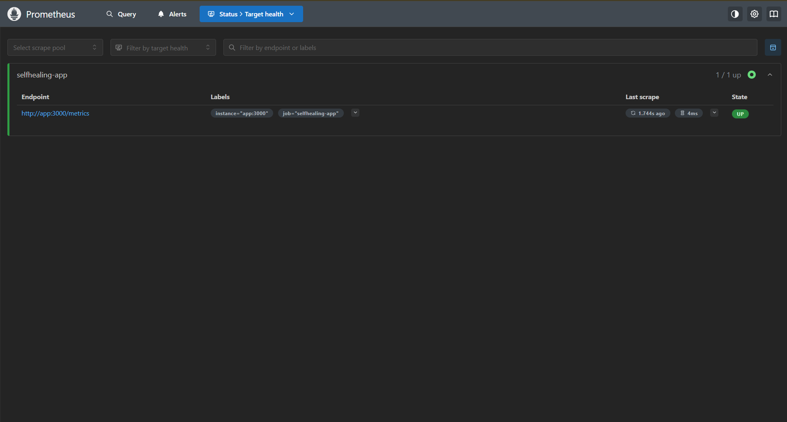

### Prometheus Alert Firing

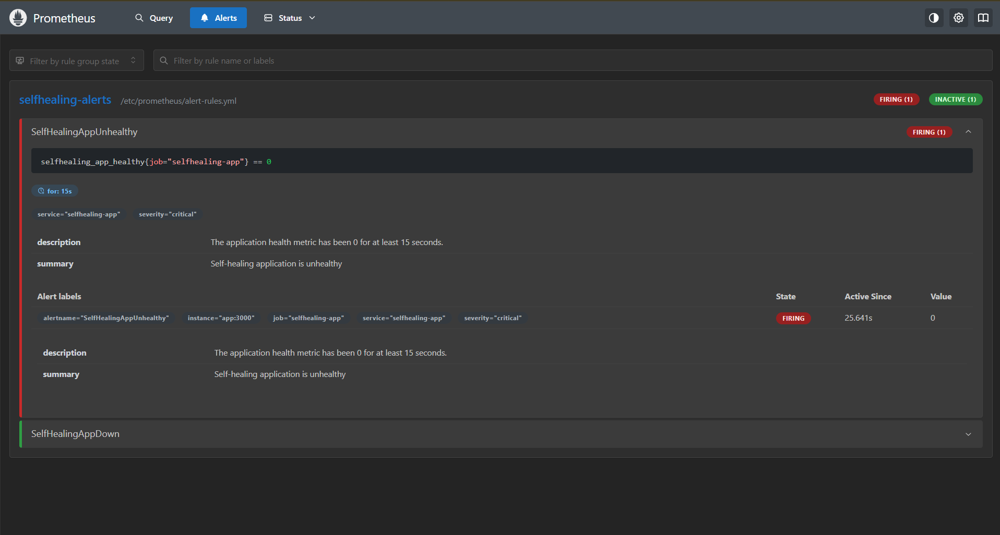

### Prometheus and Alertmanager Integration

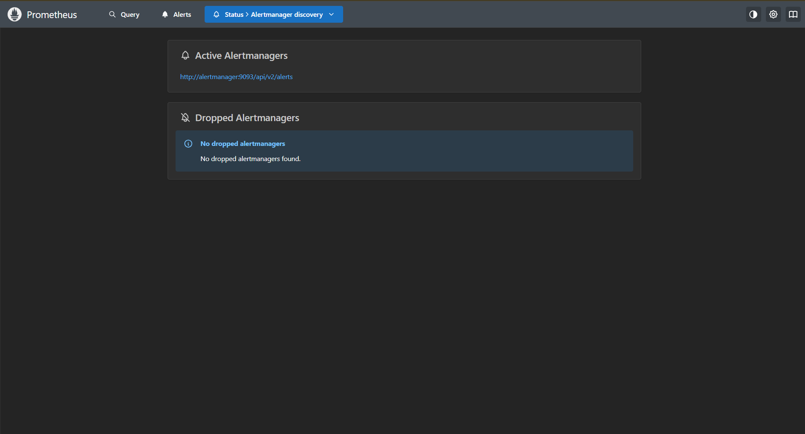

### Alertmanager Receiving Alerts

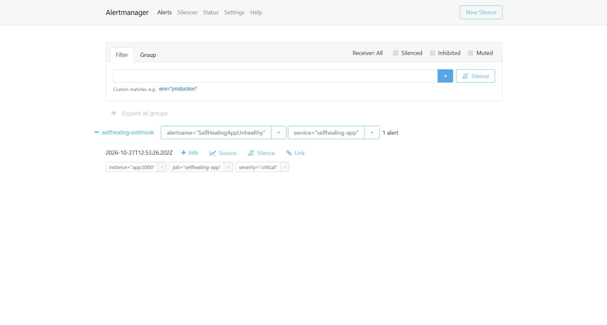

### Manual Ansible Recovery

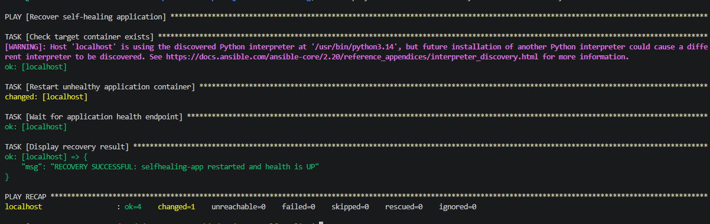

### Automatic Recovery

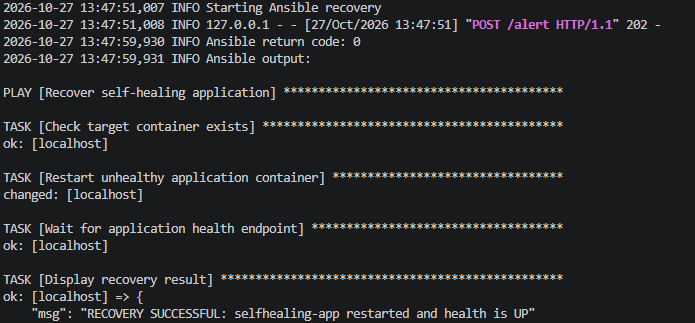

### Application Health After Recovery

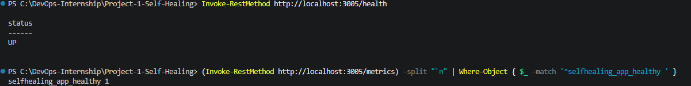

### Concurrent Recovery Protection

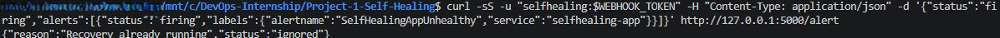

### Cooldown Verification

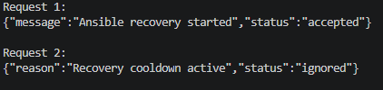

### Recovery Audit Logs

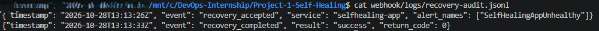

### Healthy Application Protection

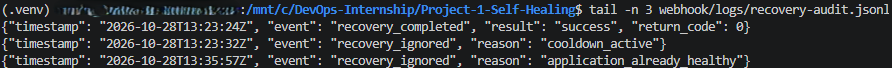

### Final Automatic Recovery


### Recovery Failure Handling


---

## 12. Security Considerations

- Webhook authentication is required.
- Authentication tokens are excluded from Git.
- Docker management is performed through Ansible in Ubuntu WSL2.
- Only recognized alert names are accepted.
- Concurrent recovery requests are blocked.
- Recovery cooldown limits repeated restarts.
- Healthy applications are protected against unnecessary recovery.
- Recovery events are recorded for auditing.

**This implementation is intended for local demonstration and educational purposes.** Production deployments would require stronger network isolation, TLS, persistent coordination, and a hardened webhook server.

---

## 13. Conclusion

This project demonstrates an automated self-healing infrastructure using Prometheus, Alertmanager, Flask, Ansible, and Docker.

The system detects application failures, initiates recovery without manual intervention, verifies application health, and records recovery outcomes.

Additional safeguards improve reliability by preventing duplicate restarts, enforcing cooldown periods, and avoiding unnecessary recovery when the application is already healthy.

The project demonstrates practical DevOps skills in infrastructure monitoring, alert management, automation, incident recovery, and operational troubleshooting.

---

**Developed for the Elevate Labs DevOps Internship.**