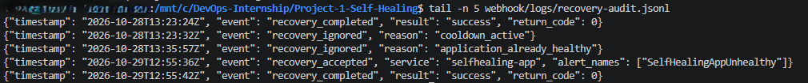
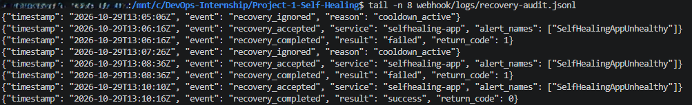
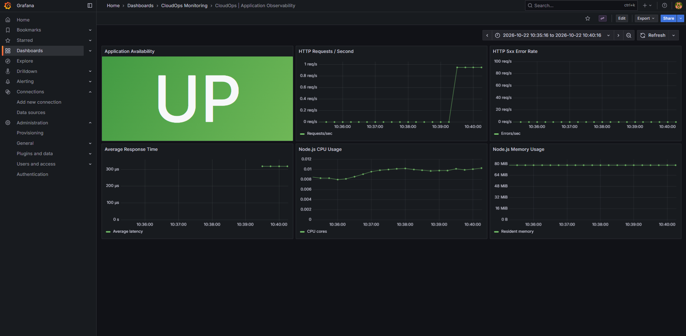
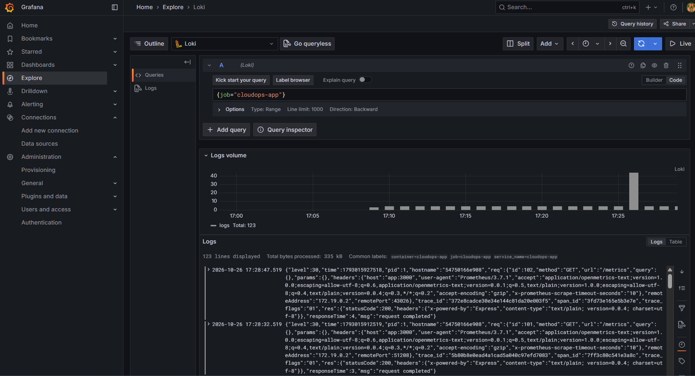
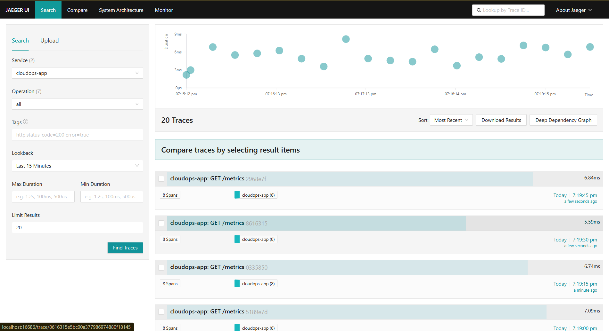

# DevOps Internship — Final Projects

**Elevate Labs | DevOps Internship**

This repository contains two completed DevOps projects demonstrating application observability, automated failure detection, and self-healing infrastructure.

## Projects

| Project | Description | Technologies |
|---|---|---|
| **Project 1 — Self-Healing Infrastructure** | Detects application failures and automatically restores service availability. | Prometheus, Alertmanager, Ansible, Python Flask, Docker |
| **Project 3 — Complete Observability System** | Provides application metrics, centralized logs, and distributed tracing. | Prometheus, Grafana, Loki, Alloy, OpenTelemetry, Jaeger, Docker |

---

## Project 1 — Self-Healing Infrastructure

**[View Project 1 Documentation](Project-1-Self-Healing/README.md)**

This project monitors a Docker-based Node.js application and automatically recovers it when a failure is detected.

### Architecture

```text
Node.js Application
        |
        v
Prometheus
        |
        v
Alertmanager
        |
        v
Python Flask Webhook
        |
        v
Ansible Playbook
        |
        v
Docker Container Restart
        |
        v
Application Health Verification
```

### Features

- Prometheus application health monitoring
- Automatic failure detection and alerting
- Alertmanager webhook integration
- Ansible-based container recovery
- Concurrent recovery prevention
- 120-second recovery cooldown
- Healthy-application protection
- Persistent recovery audit logging
- Recovery success and failure tracking

### Project 1 — Evidence

**Successful Automatic Recovery**



**Recovery Failure Handling**



---

## Project 3 — Complete Observability System

**[View Project 3 Documentation](Project-3-Observability/README.md)**

This project implements an integrated observability platform for a containerized Node.js application.

### Architecture

```text
                   Node.js Application
                            |
              +-------------+-------------+
              |             |             |
              v             v             v
         Prometheus        Alloy     OpenTelemetry
              |             |             |
              v             v             v
           Grafana         Loki         Jaeger
```

### Features

- Prometheus application metrics
- Grafana monitoring dashboard
- HTTP request and error monitoring
- CPU and memory metrics
- Centralized JSON logging
- Loki and Alloy integration
- OpenTelemetry instrumentation
- Jaeger distributed tracing
- Docker Compose deployment

### Project 3 — Evidence

**Grafana Dashboard**



**Centralized Logs**



**Distributed Tracing**



---

## Repository Structure

```text
DevOps-Internship-Final/
├── Project-1-Self-Healing/
│   ├── alertmanager/
│   ├── ansible/
│   ├── app/
│   ├── prometheus/
│   ├── webhook/
│   ├── screenshots/
│   ├── docker-compose.yml
│   └── README.md
│
├── Project-3-Observability/
│   ├── alloy/
│   ├── app/
│   ├── grafana/
│   ├── loki/
│   ├── otel/
│   ├── prometheus/
│   ├── screenshots/
│   ├── docker-compose.yml
│   └── README.md
│
├── reports/
├── .gitignore
└── README.md
```

## Development Environment

- Windows 11
- Visual Studio Code
- Docker Desktop
- Ubuntu WSL2
- Node.js
- Python and Flask
- Ansible
- Git and GitHub

## Project Reports

Individual project reports will be stored in the `reports/` directory.

Each report will contain:

1. Introduction
2. Abstract
3. Tools Used
4. Steps Involved in Building the Project
5. Conclusion

## Conclusion

These projects demonstrate two complementary DevOps capabilities.

**Project 1** implements automated incident recovery through monitoring, alerting, and infrastructure automation.

**Project 3** provides application visibility through metrics, centralized logs, and distributed traces.

Together, they demonstrate practical skills in containerization, observability, automation, troubleshooting, and application reliability.

---

**Developed as part of the Elevate Labs DevOps Internship.**